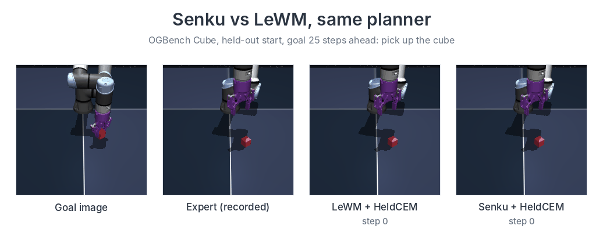
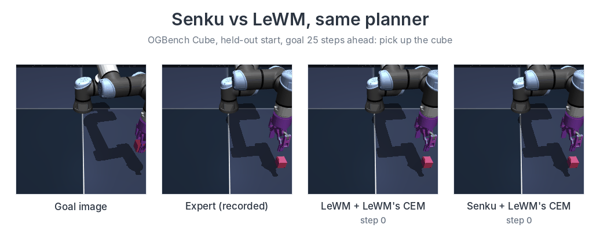

# Senku: a world model with a global latent and state tokens

Senku is a self-supervised world model for planning from pixels. Each frame becomes a global latent and 49 state
tokens. The state tokens keep spatial detail, such as the cube and the gripper fingers in OGBench Cube. Senku trains on pixels and
actions only, with a LeWM-style objective. On AntMaze it also takes the ant's joint readings, as H-JEPA's models do.

<p align="center">
  
</p>
<p align="center"><sub>One held-out OGBench Cube start (goal 25 steps ahead), same planner (HeldCEM) for both models.
On all such pick starts, Senku succeeds in 37% and LeWM in 9%.</sub></p>

<p align="center">
  
</p>
<p align="center"><sub>Another held-out pick start, both models with LeWM's own CEM planner. Senku (expert, trained on
the same data as LeWM) grasps the cube; LeWM pushes it away.</sub></p>

<p align="center">
  
</p>

## Results

Success rate (%), held-out starts, same planner for both models in each row. Senku (expert) trains on the same data
as LeWM. Senku (Cube mix) adds generated grasp data.

| Benchmark | Planner | LeWM | Senku (expert) | Senku (Cube mix) |
|---|---|---|---|---|
| OGBench Cube, LeWM's protocol | HeldCEM | 74.2 | 86.0 | **88.8** |
| OGBench Cube, LeWM's protocol | LeWM's CEM | 67.0 | **82.4** | 75.6 |
| OGBench Cube, starts that need a grasp | HeldCEM | 9.0 | 28.0 | **37.3** |
| OGBench Cube, place the held cube away (+50) | HeldCEM | **57.0** | 29.7 | 11.0 |
| OGBench Cube, H-JEPA's 50 tasks (their goal, +19) | HeldCEM | 20.7 | 64.7 | **68.7** |
| PushT, LeWM's protocol | gradient planner | 90.2 | **92.0** | |
| PushT, LeWM's protocol | LeWM's CEM | **85.4** | 80.0 | |
| PushT, LeWM's protocol, Senku at 140k steps (10 LeWM epochs) | gradient planner / LeWM's CEM | 90.2 / **85.4** | **90.8** / 77.8 | |
| Visual AntMaze, H-JEPA's 50 tasks (with joint readings) | gradient planner | 14.0, 1 seed (18.0 in H-JEPA's paper) | 25.3 | |

Senku is ahead of LeWM on the Cube tests that need a grasp, and behind it on placing a held cube away. On PushT the
two models do not differ with the gradient planner (p = 0.32) and Senku is behind with LeWM's CEM (p = 0.009), also
when trained for the same number of steps as LeWM's 10 epochs. On AntMaze,
H-JEPA with 3 levels (73.3) is far ahead of both. The planner for each benchmark is chosen on validation starts;
on Cube that choice is the gradient planner with the hold, and its test runs are still running.
[docs/RESULTS.md](docs/RESULTS.md) has all results, the paired tests and the limitations.

## Documentation

| File | Content |
|---|---|
| [docs/USAGE.md](docs/USAGE.md) | setup, data, training and evaluation commands |
| [docs/ARCHITECTURE.md](docs/ARCHITECTURE.md) | the model and its training |
| [docs/PLANNING.md](docs/PLANNING.md) | HeldCEM, LeWM's CEM and the gradient planner |
| [docs/RESULTS.md](docs/RESULTS.md) | results per benchmark, ablations, analysis |
| [docs/CREDITS.md](docs/CREDITS.md) | the papers and code that Senku uses, and what is new |

## Quick start

```bash
git clone https://github.com/gzee3184/senku_wm.git && cd senku_wm
pip install -r requirements.txt -e ".[dev]" --extra-index-url https://download.pytorch.org/whl/cu128  # exact versions
export SENKU_HOME=/path/to/storage                    # data in $SENKU_HOME/data
python train.py --checkpoint-dir runs/cube --compile  # Cube, LeWM's expert data
python eval.py --ckpt runs/cube/step_100000.pt --env cube --seed 42 --holdout-mod 10
```

Checkpoints for every Senku model in [docs/RESULTS.md](docs/RESULTS.md) are on Hugging Face:
[abrar008/Senku_WM](https://huggingface.co/abrar008/Senku_WM).

```bash
hf download abrar008/Senku_WM cube/senku_expert_100k.pt --local-dir $SENKU_HOME/checkpoints
python eval.py --ckpt $SENKU_HOME/checkpoints/cube/senku_expert_100k.pt --env cube --seed 42 --holdout-mod 10
```

## Layout

```
senku/                model, encoder, losses, data, planning, Cube start filters
senku/long_horizon/   optional long-horizon modules
senku/envs/           Cube and Scene helpers, Visual AntMaze env (from H-JEPA, MIT)
train.py              training
eval.py               Cube, PushT and Scene evaluation
eval_antmaze*.py      Visual AntMaze evaluation
scripts/data/         data generation and the rendering check
tests/                CPU tests
```

## Acknowledgements

Senku builds on [LeWM](https://github.com/lucas-maes/le-wm) ([paper](https://arxiv.org/abs/2603.19312)): SIGReg,
the projector and the evaluation protocol. It uses [stable-worldmodel](https://github.com/galilai-group/stable-worldmodel)
for environments and CEM. The Visual AntMaze environment, its tasks and the gradient planner settings come from
[H-JEPA](https://github.com/kevinghst/H-JEPA) ([paper](https://arxiv.org/abs/2610.06805)). The sparse latent
regularizer (RDMReg) follows arXiv 2608.22764. [docs/CREDITS.md](docs/CREDITS.md) lists every source.

## Citation

See [CITATION.cff](CITATION.cff).

## License

MIT. See [LICENSE](LICENSE).
