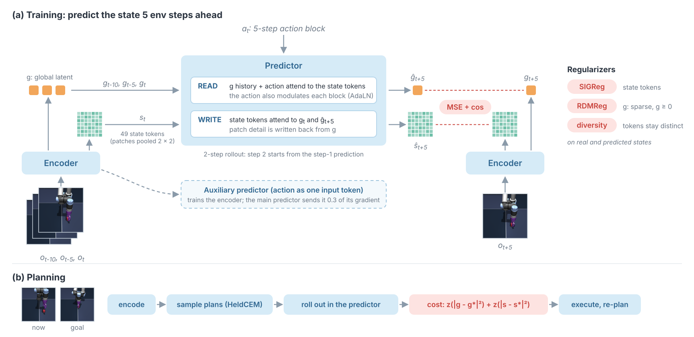

# Architecture

Senku is a joint-embedding world model. It learns from pixels and actions only: no rewards, no reconstruction, no
pretrained encoder. On AntMaze it can also take the ant's joint readings, as H-JEPA's models do (see "Joint
readings" below). A planner uses the model to reach a goal image ([PLANNING.md](PLANNING.md)).

## State

The encoder maps one 224 x 224 frame to two parts:

- **g**, a global latent (192 numbers). A projector (Linear, BatchNorm, GELU, Linear, as in LeWM) and a ReLU make it
  sparse and non-negative. The ReLU passes the GELU gradient backward, so no unit stays at zero.
- **s**, 49 state tokens (192 numbers each). These are the 196 patch tokens (14 x 14), average-pooled 2 x 2.

LeWM keeps only a global latent. Senku also keeps the state tokens. In our earlier Cube models, a linear probe read
the cube position with 27 to 57% less error from the patch tokens than from the global latent. The planning cost
uses both parts.

## Encoder

A convolutional stem (4 stages, stride 2 each) gives 14 x 14 patch tokens. A 2-D sine position code and a learned
global token are added. A 5-block ViT (192 wide, 3 heads) follows. About 3.7 M parameters.

**Input size.** All benchmarks use 224 x 224 frames. AntMaze frames are 64 x 64 and are upsampled to 224 x 224, so
the encoder does about 12 times more work than the image needs (224² / 64²). We keep one input size for all
benchmarks.

**Joint readings (AntMaze only, `--proprio`).** An MLP embeds the 27 joint readings (qpos without xy, and qvel) and
adds them to the global token before the ViT. Its last layer starts at zero, so at step 0 the model is the image-only
model.

## Predictor

One step predicts the state 5 env steps ahead. The inputs are three history latents (g at t-10, t-5, t), the state
tokens at t and one action block (the 5 actions of the next 5 env steps; 25 numbers for Cube). The predictor has two
parts:

- **READ.** The g history and an action token attend to each other and to the state tokens (cross-attention). The
  action also sets the scale, shift and gate of each block (AdaLN-zero, as in DiT). The output is g at t+5.
- **WRITE.** The state tokens attend to each other and to (g at t, predicted g at t+5). The output is the state tokens
  at t+5. The action reaches the tokens only through g.

Both outputs are zero-initialized residuals, so the predictor starts as the identity.

## Training

Each sample has 3 context frames and 2 target frames, all 5 env steps apart. The predictor predicts target 1 from
the real context. Then it predicts target 2 from its own prediction (a 2-step rollout).

| Term | Applies to | Weight |
|---|---|---|
| prediction loss: MSE + cosine distance | g (half) and the 49 state tokens (half); each token is weighted by how much it changed | 1 (rollout step 2 counts half of step 1) |
| SIGReg (LeWM's isotropic Gaussian test) | the 196 patch tokens of the real frame; the 49 predicted state tokens | 0.08; 0.04 |
| diversity (pairwise cosine) | g and the 196 patch tokens of the real frame; g and the 49 predicted state tokens | 0.05; 0.025 |
| SIGReg on patch residuals (each patch minus the frame mean) | the 196 patch tokens of the real frame | 0.03 |
| RDMReg (sliced distance to a rectified Laplace) | g | 10 |
| inverse dynamics (optional, `--w-idm`, off by default) | an MLP predicts the action block from (g at t, g at t+5) | 0 |

**Auxiliary predictor.** A second predictor gets the action as one input token (no AdaLN). The encoder learns
through this predictor. The main predictor sends only 0.3 of its gradient to the encoder. In our Cube tests at 40k
steps, the encoder without this split gave a cube move about 3 times less latent change, and place_away success fell
(see [RESULTS.md](RESULTS.md), "Ablations").

**Optimizer.** AdamW, lr 1e-4 (encoder 0.3 x), weight decay 1e-3, batch 128, 5k warmup, cosine to 0.1 x, bf16.
Cube: 100k steps. PushT: 150k steps at peak lr 2e-4, then a new warmup and cosine at peak 1e-4 to 250k, and again to 400k. AntMaze:
300k steps.

**Size.** 15.5 M parameters: encoder 3.7 M, projector 0.8 M, predictor 6.9 M, auxiliary predictor 4.1 M. Planning
does not use the auxiliary predictor, so the planner uses 11.4 M. LeWM has 18.0 M. One RTX 6000 Blackwell trains about 4 steps/s with `--compile`.

## Long horizon (optional modules)

`senku/long_horizon/` plans past the 25 to 100 steps that one plan covers. All modules use the frozen world model;
none uses rewards.

- **Imagined subgoals** (`subgoals.py`): a coarse plan over the full horizon in imagination. The model's own latents
  every 25 steps become the subgoals.
- **Action repertoire** (`repertoire.py`): a goal-blind model of how the training data moves from a state. It
  proposes 25-step action chunks. A steps-apart head (`td_head.py`) scores the imagined results.
- **Upper levels** (`upper_levels.py`): H-JEPA-style levels trained on the frozen features (stride 2 per level, 4-d
  latent macro-actions). The top level plans first and gives the next level its subgoal.

[RESULTS.md](RESULTS.md) gives what these modules achieve.
